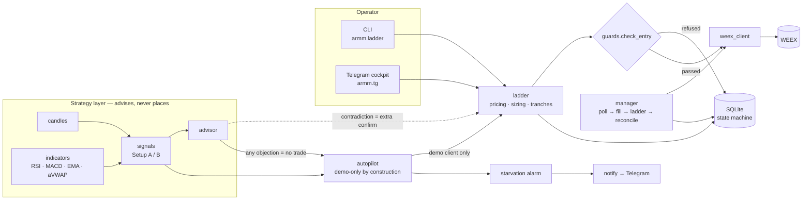

# ARMM — a risk-first execution engine for crypto futures

[](https://github.com/gladkiandrew/armm/actions/workflows/tests.yml)


ARMM is the execution engine I built for my own crypto futures trading. I make
the call; the bot places the orders, enforces my written risk rules, tells me
when my setups form, and flags when a trade contradicts them. A demo-locked
autopilot trades the same rules on simulated money, so the strategy-as-coded can
be measured against my discretionary record.

**No LLM is anywhere near the order path.** Signals, sizing, guards and execution
are deterministic Python. Claude has exactly one job: after `/check` has computed
its verdicts, it explains them in plain English (optional, with your Anthropic API
key). It never sees the order path, and `make check` proves that on every push. I
build with AI coding agents (Claude Code on a Claude Max subscription); the design,
the rules and every acceptance test are mine.

| | |
|---|---|
| Language | Python 3.12, standard library only (the optional `/check` explainer adds `anthropic`) |
| Venue | WEEX USDT-margined perpetuals (native REST client) |
| State | SQLite state machine |
| Interface | CLI + Telegram cockpit (chat-id lockdown) |
| Tests | 289 offline unit tests, no network, no keys |
| Safety | invariants proven by `make check` on every push (AST + runtime) |
| Runs on | a self-managed Linux VPS under systemd |

## Architecture



Only `ladder` and `manager` can call an order function, and CI asserts that from
the AST on every push. Everything in the strategy layer is pure computation.

## What's worth reading

- **[`armm/guards.py`](armm/guards.py)**: the single risk gate. Max 5x leverage, max $2,500 notional, max 3 positions, mandatory atomic stop, cooldowns, chase guard, −6% daily auto-halt, kill switch. Every entry path calls it, and it runs again right before the wire call.
- **[`armm/autopilot.py`](armm/autopilot.py)**: demo-only *by construction*, not by setting. It never imports the live order path, hard-codes `demo=True` at every call site, and re-checks routing before every order. `make demo-lock` proves all three.
- **[`armm/research.py`](armm/research.py)**: the parameter sweep, anchored to confirmed swing lows to avoid look-ahead. It found that the best parameter sets were statistically indistinguishable, so the report says "keep the defaults" instead of presenting a fake best set.
- **[`armm/starvation.py`](armm/starvation.py)**: tells "the market offered nothing" apart from "a setup fired and something blocked it." Built after autopilot sat for a month refusing 335 valid signals with no alarm ([story below](#starvation-detection-v05)).
- **[`armm/explain.py`](armm/explain.py)**: where Claude is allowed in, and how it's kept out of everything else. It sees only the finished `/check` readout, a reply that states any number not already in that readout is dropped, and it fails quiet so the cockpit never waits on it.
- **[`docs/BUILD_LOG.md`](docs/BUILD_LOG.md)**: what broke, why, and the fix, release by release. The real engineering record.

## Safety invariants (`make check`, enforced in CI)

| Check | What it proves |
|---|---|
| `self-check` | every prerequisite of `check` has a real recipe, so a green run can't be vacuous |
| `compile` + `test` | every module compiles; 289 offline unit tests pass in an isolated temp home |
| `secrets` | no env file is tracked and no credential value appears anywhere in the tree |
| `no-new-order-paths` | from the AST: only `ladder.py` and `manager.py` call an order function; the live endpoint constant is unchanged |
| `no-llm-in-decisions` | from the AST: none of the 16 modules that compute, size, guard, place or record a trade imports the explainer or the model SDK, and the explainer imports nothing that trades |
| `demo-lock` | autopilot never names the live path, builds clients only with a literal `demo=True`, takes no live/force parameter, and at runtime refuses six kinds of live-ish client |

## Quickstart (offline, no keys)

```bash
git clone https://github.com/gladkiandrew/armm && cd armm
python3 -m armm.demo                           # risk gate + a full backtest, under 1 second
make compile test secrets no-new-order-paths   # offline checks, no keys needed
# `make check` adds the runtime demo-lock proof, which needs demo API credentials
python3 -m armm.ladder BTCUSDT LONG --entry 78200 --stop 77400 --targets 78600,79000,79400 --notional 500 --dry-run
```

`armm.demo` runs the real risk gate on six proposed entries, then backtests Setup B
over a year of **synthetic** candles (a seeded random walk, not market data) with the
same signal path, trade simulator and statistics `research.py` uses:

```
1) RISK GATE — every entry path calls this before an order leaves the process
   clean long         ALLOW
   oversized          REFUSE  notional $5000 > cap $2500
   too much leverage  REFUSE  leverage 20x > cap 5x
   no stop            REFUSE  no stop price — stops are mandatory, placed atomically with entry
   chasing the move   REFUSE  chase guard: entry 2.6% above reference (max 2.0%)
   revenge trade      REFUSE  cooldown: BTCUSDT locked for 26 more min (anti-revenge rule)

2) SETUP B BACKTEST — synthetic data, real decision code
   trades        136
   win rate      28.7%
   expectancy    +0.073 R per trade (± 0.172 SE)
   profit factor 1.09

3) IS IT REAL?
   |expectancy| 0.073 R is inside 2 SE (0.344 R): indistinguishable from noise. Don't trade it, don't tune it.
```

That last line is the point: a positive number is not an edge until it clears the
noise band, and the same check is built into the real research reports.

Credentials, if you ever run it against an exchange, live only in `~/armm/.env`
(chmod 600). Nothing secret is in this repo.

## Repository layout

```
armm/
  guards.py         the single risk gate — every entry path calls check_entry
  ladder.py         entry pricing, sizing, tranche math, placement + veto retry (CLI and library)
  manager.py        poll → fill → tranche ladder → reconcile loop (the systemd service)
  weex_client.py    native REST client: POST_ONLY, atomic SL/TP, sim routing, rate pacing
  store.py          SQLite state machine at ~/armm/armm.db
  tg.py             Telegram cockpit (long-poll, chat-id lockdown)
  notify.py         Telegram push, queued at max 1 msg/sec
  indicators.py     RSI / MACD / EMA / ATR / anchored-VWAP maths — pure, zero network
  candles.py        kline fetch, normalization, backward pagination, CSV cache
  signals.py        Setup A/B evaluation + the swing-low anchor heuristic
  advisor.py        compares an intended ladder against the live snapshot
  research.py       offline Setup B parameter sweep → a markdown report
  autopilot.py      the demo-locked strategy engine
  starvation.py     tells "blocked" apart from "quiet" — the health alarm
  scoreboard.py     AUTO vs MANUAL track record
  origin.py         order attribution — every client id says where it came from
  specs.py          per-symbol contract specs (24h cache) + all rounding math
  config.py         paths + the only reader/writer of ~/armm/.env
  logsetup.py       rotating ~/armm/bot.log with secret redaction
  explain.py        optional: Claude explains a /check readout; never decides
  demo_lock_check.py  runtime half of acceptance test 1
  demo.py           offline demo: risk gate + synthetic-data backtest, no keys
tests/              289 offline unit tests (test_armm, test_signals, test_autopilot, test_starvation, test_demo, test_explain)
deploy/             armm-bot.service — hardened systemd template, installed manually
docs/BUILD_LOG.md   lessons, release by release
```

## Run

```bash
# auto-priced entry: 40 points below the live last price, 1% stop, 3 targets
python3 -m armm.ladder BTCUSDT LONG --offset 40 --stop-pct 1 --targets-pct 0.5,1,1.5 --notional 500

# absolute prices still work
python3 -m armm.ladder BTCUSDT LONG --entry 78200 --stop 77400 --targets 78600,79000,79400 --notional 500

# see the plan and the routing line without placing anything
python3 -m armm.ladder BTCUSDT LONG --offset 40 --stop-pct 1 --targets-pct 0.5,1,1.5 --notional 500 --dry-run

# position manager + Telegram cockpit (this is what systemd runs)
python3 -m armm.manager --symbols BTCUSDT --telegram

# one-shot reconcile against the exchange
python3 -m armm.manager --reconcile-only
```

Demo by default everywhere. `--live` requires typing CONFIRM; Telegram `live`
additionally requires the process to have been started with `--allow-live-orders`.

## Telegram cockpit

```
/status   positions, open orders, balance, PnL today, guard state
/ladder BTCUSDT LONG offset=40 notional=500 stop=1% targets=0.5,1,1.5
/halt     kill switch — no new entries (existing stops stay)
/resume   clear the halt
/last     recent order history

/check SYMBOL     price, aVWAP ± band, RSI, MACD, 4H trend, setup verdicts
                  → then Claude's plain-English read, as a second message (optional)
/anchor SYMBOL <YYYY-MM-DDTHH:MM | auto>   set the aVWAP anchor
/watch SYMBOL     alert once when a setup confirms   ·   /unwatch SYMBOL
/watching         list watched symbols and their anchors

/auto on SYMBOL   let the bot take its own setups — DEMO ACCOUNT ONLY
/auto off [SYM]   stop it (omit the symbol to stop everything)
/auto status      what autopilot is doing, and why it is not trading
/score            AUTO vs MANUAL track record
```

`/auto status` names any active block and its cause, so "ON" can never again
mean "ON and structurally unable to trade".

`stop=` and `targets=` are **percentages**; use `stopprice=` / `targetprices=` for
absolute values. The plan and its routing line are sent before anything is placed.

**Claude's read on `/check` (optional).** Add `ANTHROPIC_API_KEY=…` to `~/armm/.env`
and `pip install anthropic`. The deterministic readout arrives first, unchanged;
Claude's explanation follows as its own message, so a slow model can never delay a
`/halt`. Without the key or the package, `/check` is exactly what it was. From the
shell: `python3 -m armm.explain BTCUSDT`. `ARMM_EXPLAIN_MODEL` overrides the default
model.

**First run:** if `TELEGRAM_CHAT_ID` is blank, send `/start` from your Telegram
account — that chat is written into `~/armm/.env` and every other chat id is
refused and logged from then on.

## Ops

```bash
make check                # self-check, compile, 289 tests, secret scan, order-path, no-LLM-in-decisions + demo-lock proofs
make install-service      # prints the manual systemd install steps
tail -f ~/armm/bot.log    # rotating, 5MB x 5
```

`deploy/armm-bot.service` is a template, installed manually. It has no `--live`
and no `--allow-live-orders`: switching this bot to real money is a deliberate,
reviewed edit, not a flag someone can trip over.

## The setups (v0.3)

**Setup A — "Reload"** (longer-term long), all required:
1H RSI(14) < 40 · price below the lower aVWAP band (aVWAP − 1.0σ). MACD is
explicitly not applicable.

**Setup B — "Momentum"** (short-term leveraged long), all 3/3 plus a filter:
price above/reclaiming the aVWAP · 1H RSI rising, past 50, not above 70 ·
MACD histogram positive and expanding · 4H EMA20 > EMA50 and rising.

Setup B's thresholds are the brief's *initial* values and are marked for
optimisation — `research.py` sweeps them. `/watch` alerts once on the false→true
edge with a 1h re-alert cooldown, so a setup that stays true for six hours does
not produce six hours of messages.

### The advisor

Before any manual ladder, the bot compares the entry to the live snapshot. It
**never blocks** — I keep final authority — but a contradicted trade costs an
explicit extra confirmation tap and is written to the database
(`positions.advisor_overridden` + `advisor_notes`). The canonical case is a long
into RSI > 60 with the 4H trend down: no hard risk rule forbids it, but it
contradicts my own stated setups, so the bot says so first.

```bash
python3 -m armm.research --symbol BTCUSDT --days 365   # → ~/armm/research/
python3 -m armm.manager --check BTCUSDT                # one-shot snapshot, no orders
```

## Autopilot (v0.4)

Autopilot exists to answer one question: **how does the strategy-as-coded compare
to my own discretionary record?** It runs the identical `evaluate()` path the
cockpit uses, takes Setup A/B entries on the demo account, and `/score` puts the
two records side by side.

The demo lock is structural, and `make demo-lock` proves it three ways:
1. `autopilot.py` never names or imports the live order path.
2. Every `WeexClient` it constructs passes the **literal** `True` for `demo=`,
   written at the call site — not read from a flag, env var or command.
3. No function in the module accepts a `live`/`force`-style parameter.

Plus, at runtime, `assert_demo()` re-checks `demo`, `order_path` and `mode`
immediately before every order. If routing ever reads non-demo it refuses,
disables autopilot for every symbol, halts trading and says so loudly.

**Autopilot has no override authority.** A human may look at an advisor
contradiction and take the trade anyway; autopilot may not. Any objection at all
means no trade. It is also edge-triggered (one entry per activation of a setup),
rate-limited to one entry per symbol per 4h, obeys `/halt` instantly, and will
not resume without both `/resume` and a persisted `/auto on`.

### Order attribution

Every client id encodes its origin, so the *exchange's* record carries it too —
not just our database:

```
armm-cli-e-1788287697607     manual CLI ladder
armm-tg-e-1788287697607      manual Telegram ladder
armm-auto-e-1788287697607    autopilot (demo-only)
armm-test-e-1788287697607    acceptance test / build verification
```

`/last` shows the origin per order; test orders announce themselves as 🧪 TEST
ORDER; and `/score` excludes them from every statistic.

### Entry gates added in v0.4 (manual and auto alike)

- **Stop behind liquidation** — estimated from leverage. Uses the venue's own
  account leverage when we have observed it, because that is what actually
  governs liquidation; the requested figure is only what the guards capped.
- **Market regime** — from BTC's 4H EMA structure. Setup B is vetoed outright in
  a broken regime; Setup A additionally requires stabilisation.
- **30m justification frame** — Setup A needs the 30m oversold too (RSI < 40);
  Setup B needs the 30m not to contradict (RSI not extended, MACD histogram not
  negative). A missing 30m frame is *unknown*, and unknown is not permission.

## Guards (hard-coded, unbypassable)

Max 5x leverage · max $2,500 notional · max 3 concurrent positions · mandatory
atomic stop · 30-min per-symbol cooldown after a close · 2% chase guard vs the
anchor · −6% daily-loss auto-halt · manual kill switch. `guards.check_entry` is
called by the CLI, by Telegram, and again immediately before the wire call.

## Starvation detection (v0.5)

Autopilot ran from 2026-09-05 to 2026-10-03 taking **zero** trades. It was not
broken and the market was not quiet: 335 confirmed Setup B signals were each
refused by the stop-behind-liquidation check, because the demo account sat at
~141x where liquidation is 0.21% away and the strategy's stop is 1.00% away.
Every refusal was correct. The failure was that nothing said so — four weekly
digests reported "no trades", `/auto status` reported "ON", and a structurally
blocked autopilot was indistinguishable from a correctly idle one.

`starvation.py` makes the distinction, and the distinction is the whole design:

- **"The market is not offering a setup" is HEALTH.** `no_setup`,
  `rate_limited`, `already_acted`, `position_open`, `disabled`, `halted` — these
  accumulate nothing. If they counted, the alarm would fire constantly and be
  learned-past, which is worse than no alarm.
- **"A setup confirmed and I then refused it" is a BLOCK.** `guard_refused`,
  `advisor_refused`, `plan_failed`, `order_failed`, `unsafe_routing` — something
  upstream of the market stands between a live signal and an order, and that is
  the only thing a human can fix.

An unrecognised reason code counts as idle, deliberately: under-reporting a
novel block is recoverable, crying wolf is not.

Ten consecutive blocks (~an hour at the 5-minute poll) raises one Telegram
alarm, then goes quiet for 24h. It names the dominant cause only when a single
reason owns ≥80% of the streak — otherwise it says `mixed`, because ten blocks
for five reasons is not one config fault. The streak persists in `meta` across
restarts (`Restart=always` would otherwise reset it forever) and an entry clears
it. Any active block **leads** the weekly digest, above the statistics.

Replayed against the real September event log, it fires on **2026-09-05 13:50**,
45 minutes into the block, and 11 times across the month.

## Selected lessons

The full record is in [`docs/BUILD_LOG.md`](docs/BUILD_LOG.md). A few that shaped the design:

- **A correct guard and a working system are different claims.** Every one of the 335 refusals was right; the bot still produced nothing for a month.
- **Backtest anchoring was the difference between meaning and noise.** Rolling the aVWAP anchor to each *confirmed* swing low (no look-ahead) took Setup B from 9 trades a year to 59, and the sweep from 27 minutes to 24 seconds.
- **The sweep found nothing, and the report says so.** The gap between the #1 and #20 parameter sets is inside two standard errors of #1's own mean.
- **A `.PHONY` target with no rule is silently "already made".** A botched edit once left `make check` printing GREEN with its checks deleted; `self-check` now makes a vacuous pass impossible.
- **Telemetry must not be able to stop trading.** A bug in the health monitor must never take down the thing it monitors.

## Roadmap

Live-tiny validation of the real reduceOnly tranche ladder · cancel/replace
maker repricing · daily-loss halt wired to realized fills (`userTrades`) ·
out-of-sample validation of any parameter change · shorts. Auto-proposed and
auto-placed entries remain explicitly out of scope.

---

Built for my own trading. Demo by default; nothing here is financial advice.
